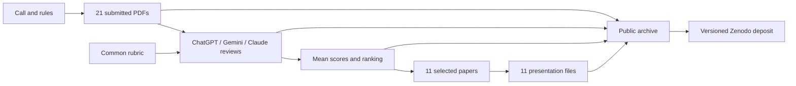

# CNSM 2026 — The Agentic AI Researcher

An archive of the **Call for AI Papers: Special Experimental Track** at the 22nd International Conference on Network and Service Management, Alcalá de Henares, Spain, 26–30 October 2026.

The experiment invited AI-generated research papers in network and service management, evaluated them using AI reviewers, and requested AI-generated presentations for a human assessment panel. This repository preserves the supplied evidence and makes the selection process inspectable.

**21 submissions · 22 human submitters · 63 review files · 11 selected papers · 11 videos**

These are experimental artifacts, outside the main CNSM proceedings and IEEE Xplore. A future Zenodo DOI will identify this archive as a collection, not confer proceedings status on its contents.

## Explore the experiment

| Start here | Contents |
|---|---|
| [All papers](papers/README.md) | Every submission, submitters, declared tools, PDFs, reviews and videos |
| [Participants and acknowledgements](PARTICIPANTS.md) | Every recorded submitter, including non-selected submissions, and the four co-chairs |
| [Results](results/README.md) | Complete ranking, reviewer totals and original Excel workbook |
| [Presentations](videos/README.md) | The 11 supplied videos, linked to their papers |
| [Methodology](docs/methodology.md) | Call, rubric, aggregation, chronology and reproducibility limits |
| [Known issues](docs/known-issues.md) | Duplicated Gemini assignment and source limitations |
| [Panel working notes, Spanish](discussion/panel-reflections.es.md) | Discussion prompts and hypotheses, not conference minutes |
| [Publish to GitHub and Zenodo, Spanish](docs/publication-guide.es.md) | Release, DOI, attribution and website instructions |

## From call to archive



The ranking uses equal reviewer weights and selects the top 11 unrounded means. **The Gemini files for papers 22 and 23 are byte-identical and describe paper 22.** Original scores remain in the historical record, with paper 23 explicitly flagged. The missing review has not been invented or substituted. See the [impact analysis](docs/known-issues.md#gemini-assignment-for-paper-23).

## Repository layout

```text
protocol/     Original call and common review prompt
papers/       21 original PDFs and paper catalogue
reviews/      Original ChatGPT, Gemini and Claude texts
results/      Original ranking workbook and readable results
videos/       11 original MP4 presentations and index
data/         Public metadata, scores, provenance and checksums
discussion/   Contextualised panel preparation notes
docs/         Methodology, data dictionary and publication guide
scripts/      Rebuild, validate and package the archive
zenodo/       Prepared attribution metadata and release notes
```

PDFs, review texts, call, prompt, videos and the results workbook are unchanged copies. One video extension was normalised to lowercase. Tables and indexes are derived files. [Provenance](docs/provenance.md) records transformations and exclusions.

The original submission workbook, private submission links, notification drafts and contact-email index are excluded. The public extract keeps names, affiliations, titles, topics, self-declared tools and agreements. **Original PDFs can contain author contact information.** See [data handling and rights](RIGHTS.md).

## Reproduce and verify

Requires Python 3.10 or later; no third-party packages, model accounts or network access.

```bash
python3 scripts/build_catalog.py --check
python3 scripts/validate_archive.py
```

After an intentional source correction, regenerate derived files and refresh the inventory:

```bash
python3 scripts/build_catalog.py
python3 scripts/validate_archive.py --write-manifest
python3 scripts/validate_archive.py
```

Checks reconcile category scores, totals, ranks and selections with the supplied workbook's cached values, verify source hashes, detect the known duplicate, check coverage and local links, and validate the SHA-256 inventory. They reproduce aggregation, not the original AI research or model executions.

## Citation and credit

Use [CITATION.cff](CITATION.cff) for the archive citation. Creators: **Pal Varga, Jaime Galán-Jiménez, Elisa Rojas and David Carrascal**. The [participant list](PARTICIPANTS.md) and [prepared Zenodo metadata](zenodo/metadata-draft.json) acknowledge all 22 submitters as collaborators. No DOI has been assigned here yet.

When reusing a particular paper or video, also identify its paper ID and credit the people and systems declared in that artifact. The archive citation does not replace individual attribution.

The existing [GPL v3 license](LICENSE) is retained. Imported artifacts are not automatically relicensed by inclusion here; see [RIGHTS.md](RIGHTS.md). Report corrections through [repository issues](https://github.com/NETSERV-UAH/cnsm-2026-cfaip/issues), record substantive changes in [CHANGELOG.md](CHANGELOG.md), and preserve released versions for citation.
